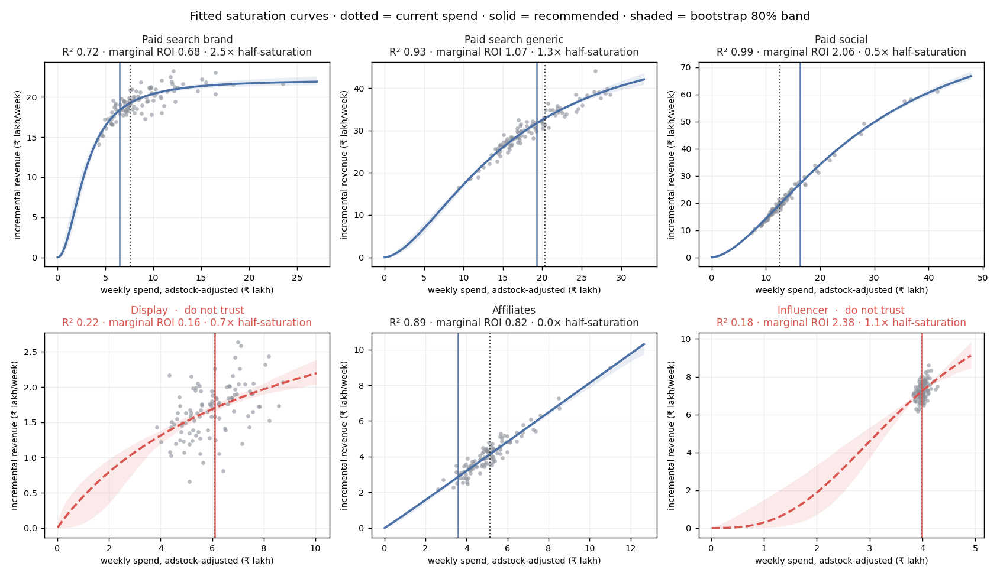

# Budget reallocation

Hill saturation curves with geometric adstock, fitted per channel on 104 weeks; SLSQP reallocation within ±30% per channel, brand floor 85%, untrusted curves frozen. Note written by: none; every number verified against the evidence pack.

## Recommendation

Move ₹3.77 L/week out of Affiliates (-30.0%), Paid search brand (-15.0%), Paid search generic (-5.4%) and into Paid social (+30.0%); the total stays at ₹55.70 L/week.
Predicted weekly incremental revenue ₹84.73 L → ₹88.98 L (+5.0%); at the low end of the bootstrap bands, +4.7%.
Paid search brand sits 2.54× past its half-saturation point (marginal ROI 0.68 (band 0.62–0.73)); Paid social has the most headroom (marginal ROI 2.06 (band 2.00–2.12)).
Not trusted yet, held at current spend: Display - fit R² 0.22 is below 0.5: too noisy to see a curve; Influencer - spend CV 0.03 is below 0.1: never varied enough to locate the knee.

*source: template (no API key)*

| Channel | Now ₹L/wk | Recommended | Change | Marginal ROI (80% band) | Saturation | R² | Trust |
|---|---:|---:|---:|---:|---:|---:|---|
| Paid search brand | 7.58 | 6.44 | -15.0% | 0.68 (0.62–0.73) | 2.54× | 0.72 | ok |
| Paid search generic | 20.35 | 19.26 | -5.4% | 1.07 (1.00–1.15) | 1.29× | 0.93 | ok |
| Paid social | 12.55 | 16.32 | +30.0% | 2.06 (2.00–2.12) | 0.45× | 0.99 | ok |
| Display | 6.10 | 6.10 | +0.0% | 0.16 (0.12–0.20) | 0.70× | 0.22 | DO NOT TRUST |
| Affiliates | 5.13 | 3.59 | -30.0% | 0.82 (0.79–0.86) | 0.01× | 0.89 | ok |
| Influencer | 3.99 | 3.99 | +0.0% | 2.38 (1.80–2.94) | 1.06× | 0.18 | DO NOT TRUST |

<details><summary>evidence</summary>

```json
{
  "units": "spend and revenue in ₹ lakh per week; bounds ±30% per channel, brand floor 85%",
  "portfolio": {
    "total_budget": 55.7,
    "moved_budget": 3.77,
    "response_before": 84.73,
    "response_after": 88.98,
    "lift_pct": 5.0,
    "conservative_lift_pct": 4.7,
    "frozen_channels": [
      "Display",
      "Influencer"
    ]
  },
  "channels": [
    {
      "channel": "Paid search brand",
      "current_spend": 7.58,
      "recommended_spend": 6.44,
      "change_pct": -15.0,
      "marginal_roi": 0.68,
      "marginal_roi_band_80": [
        0.62,
        0.73
      ],
      "saturation_share": 2.54,
      "adstock_decay": 0.1,
      "fit_r2": 0.72,
      "trusted": true,
      "trust_note": "curve is identified"
    },
    {
      "channel": "Paid search generic",
      "current_spend": 20.35,
      "recommended_spend": 19.26,
      "change_pct": -5.4,
      "marginal_roi": 1.07,
      "marginal_roi_band_80": [
        1.0,
        1.15
      ],
      "saturation_share": 1.29,
      "adstock_decay": 0.1,
      "fit_r2": 0.93,
      "trusted": true,
      "trust_note": "curve is identified"
    },
    {
      "channel": "Paid social",
      "current_spend": 12.55,
      "recommended_spend": 16.32,
      "change_pct": 30.0,
      "marginal_roi": 2.06,
      "marginal_roi_band_80": [
        2.0,
        2.12
      ],
      "saturation_share": 0.45,
      "adstock_decay": 0.4,
      "fit_r2": 0.99,
      "trusted": true,
      "trust_note": "curve is identified"
    },
    {
      "channel": "Display",
      "current_spend": 6.1,
      "recommended_spend": 6.1,
      "change_pct": 0.0,
      "marginal_roi": 0.16,
      "marginal_roi_band_80": [
        0.12,
        0.2
      ],
      "saturation_share": 0.7,
      "adstock_decay": 0.3,
      "fit_r2": 0.22,
      "trusted": false,
      "trust_note": "fit R² 0.22 is below 0.5: too noisy to see a curve"
    },
    {
      "channel": "Affiliates",
      "current_spend": 5.13,
      "recommended_spend": 3.59,
      "change_pct": -30.0,
      "marginal_roi": 0.82,
      "marginal_roi_band_80": [
        0.79,
        0.86
      ],
      "saturation_share": 0.01,
      "adstock_decay": 0.1,
      "fit_r2": 0.89,
      "trusted": true,
      "trust_note": "curve is identified"
    },
    {
      "channel": "Influencer",
      "current_spend": 3.99,
      "recommended_spend": 3.99,
      "change_pct": 0.0,
      "marginal_roi": 2.38,
      "marginal_roi_band_80": [
        1.8,
        2.94
      ],
      "saturation_share": 1.06,
      "adstock_decay": 0.3,
      "fit_r2": 0.18,
      "trusted": false,
      "trust_note": "spend CV 0.03 is below 0.1: never varied enough to locate the knee"
    }
  ]
}
```
</details>


